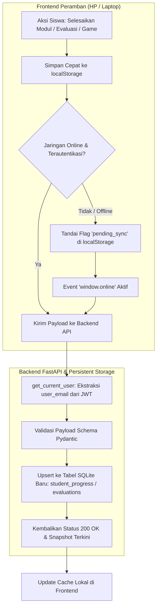

# NUMORA SPACE — AUDIT KHUSUS ARSITEKTUR PENYIMPANAN DATA
**Laporan Analisis Persistensi Data, Penggunaan Browser Storage, Backend Database, dan Desain Sinkronisasi Lintas Perangkat**

**Tanggal Audit:** 23 November 2026  
**Aplikasi:** NUMORA Space — *Algebra, Beyond Formulas.*  
**Status Evaluasi:** Prapublikasi & Penguatan Arsitektur Data  

---

## 1. PENDAHULUAN & LATAR BELAKANG AUDIT

Pada audit fungsionalitas sebelumnya, ditemukan temuan arsitektural krusial:
1. Progres modul belajar siswa disimpan secara eksklusif di `localStorage` peramban client.
2. Hasil evaluasi mandiri (10 butir soal aljabar) disimpan secara eksklusif di `localStorage` peramban client.
3. Rekor dan statistik permainan 3D NUMORA RUN disimpan di `localStorage` peramban client.
4. Belum ada mekanisme sinkronisasi data belajar siswa antarperangkat (HP dan laptop) ke database backend.

Audit khusus ini bertujuan membedah kondisi penyimpanan data secara menyeluruh di frontend dan backend, mengevaluasi peran Supabase, memetakan risiko integritas data, serta menyusun rancangan sinkronisasi data lintas perangkat yang aman dan kompatibel tanpa merusak data penelitian maupun skema yang sudah ada.

---

## 2. INVENTARISASI PENYIMPANAN DATA DI SISI FRONTEND (BROWSER STORAGE)

Berdasarkan penelusuran kode sumber pada seluruh direktori `frontend/src/`, ditemukan 4 kunci utama yang disimpan di peramban (`localStorage` & `sessionStorage`):

| No | Kunci Penyimpanan (Storage Key) | Lokasi File Implementasi | Tipe Penyimpanan | Struktur & Isi Data | Keterangan & Isolasi Akun |
| :--- | :--- | :--- | :--- | :--- | :--- |
| 1 | `numora_auth_session` | `frontend/src/context/AuthContext.jsx`<br>`frontend/src/services/api.js` | `localStorage` (jika *rememberMe: true*) / `sessionStorage` | JSON Object:<br>`{ email, role, name, subjectId, grade, token, loginTime }` | **Terisolasi.** Menyimpan token JWT dan profil sesi pengguna yang sedang login. Dibersihkan saat logout. |
| 2 | `numora_student_progress_${studentKey}` | `frontend/src/pages/StudentDashboard.jsx` | `localStorage` | JSON Array of Strings:<br>`['MOD-01', 'MOD-02', ...]` | **Terisolasi parsial.** Menggunakan `studentKey = user?.subjectId \|\| user?.email \|\| 'default_student'`. Menampung ID modul yang telah selesai dipelajari. |
| 3 | `numora_evaluation_results_${studentId}` | `frontend/src/features/learning/MathematicalChallenge.jsx` | `localStorage` | JSON Object:<br>`{ score, accuracy, totalQuestions, correctCount, wrongCount, categoryResults, detailedResults, timestamp }` | **Terisolasi parsial.** Menggunakan `studentId = user?.subjectId \|\| 'S-002'`. Menyimpan rekam jejak penilaian 10 soal dan analisis miskonsepsi. |
| 4 | `numora_runner_data_v1` | `frontend/src/features/runner/runnerStorage.js` | `localStorage` | JSON Object:<br>`{ highScores: { beginner, intermediate, advanced, expert }, totalGames, totalCoins, totalAnswered, totalCorrect, recentSessions: [...] }` | ⚠️ **TIDAK TERISOLASI (GLOBAL).** Kunci bersifat global tanpa embel-embel ID pengguna. Semua akun yang bermain di peramban yang sama saling menimpa statistik game. |

### Temuan Khusus di Sisi Penelitian (`ResearcherDashboard.jsx`):
- `ResearcherDashboard.jsx` memuat data subjek penelitian (S-001 dan S-002) dan log sesi penelitian **langsung dari backend API** (`GET /api/v1/research/subjects` dan `GET /api/v1/research/sessions`).
- `ResearcherDashboard.jsx` **secara eksplisit menolak** membaca data evaluasi dari `localStorage` siswa (`research_data_integrity_notice: 'Client-side evaluation results are excluded because they are not verified research records.'`). Hal ini dilakukan agar pengerjaan coba-coba di peramban tidak mengkontaminasi catatan penelitian formal.

---

## 3. AUDIT KONDISI DATABASE, MODEL, SERVICE & ENDPOINT BACKEND

### A. Tabel SQLite Aktual di Backend (`backend/app/data/security_store.db`)
Pemeriksaan langsung pada implementasi `PersistentSecurityStore` (`backend/app/services/token_revocation_store.py`) menunjukkan bahwa SQLite saat ini **hanya mengelola 3 tabel keamanan**:

```sql
-- 1. Tabel Blacklist Token Kedaluwarsa / Logout
CREATE TABLE revoked_tokens (
    jti TEXT PRIMARY KEY,
    expires_at INTEGER NOT NULL,
    revoked_at INTEGER NOT NULL
);

-- 2. Tabel Sliding-Window IP Rate Limiting
CREATE TABLE login_rate_limits (
    id INTEGER PRIMARY KEY AUTOINCREMENT,
    ip TEXT NOT NULL,
    attempt_time INTEGER NOT NULL
);

-- 3. Tabel Akun Pengguna Terdaftar
CREATE TABLE users (
    email TEXT PRIMARY KEY,
    hashed_password TEXT NOT NULL,
    role TEXT NOT NULL,
    name TEXT NOT NULL,
    subject_id TEXT NOT NULL,
    grade TEXT NOT NULL,
    description TEXT,
    auth_provider TEXT NOT NULL DEFAULT 'local',
    created_at INTEGER NOT NULL,
    is_provisioned_researcher INTEGER DEFAULT 0
);
```

### B. Evaluasi Service & Store Backend
1. **`token_revocation_store.py`:** Berjalan di atas SQLite dengan ACID compliance (`BEGIN IMMEDIATE`), thread locking, dan busy timeout 15 detik.
2. **`research_store.py`:** Bersifat **IN-MEMORY** (`self._subjects: Dict` dan `self._sessions: List = []`). Tidak tersimpan di file SQLite maupun database eksternal. Jika uvicorn server restart, seluruh sesi riset yang dimasukkan ke instance ini akan hilang.
3. **`math_engine.py` & `nora_ai_service.py`:** Komponen komputasi murni tanpa persistensi state database.

### C. Daftar Seluruh Endpoint Backend API (`/api/v1/`)
- `/api/v1/health`, `/api/v1/live`, `/api/v1/ready`, `/api/v1/info` (Monitoring sistem)
- `/api/v1/auth/google`, `/api/v1/auth/me`, `/api/v1/auth/logout` (Autentikasi & sesi)
- `/api/v1/math/evaluate`, `/api/v1/math/diagnose-misconception` (Kalkulasi matematika & diagnosis)
- `/api/v1/nora/chat` (AI Sokratik)
- `/api/v1/research/subjects`, `/api/v1/research/sessions`, `/api/v1/research/cognitive-load-status` (Akses peneliti, RBAC)

> [!WARNING]
> **Ketiadaan Fitur Persistensi Siswa di Backend:**
> Backend saat ini **TIDAK MEMILIKI:**
> - Tabel database untuk menyimpan modul selesai siswa (`completed_modules`).
> - Tabel database untuk menyimpan skor dan lembar jawaban evaluasi (`evaluations`).
> - Tabel database untuk menyimpan rekor game (`runner_records`).
> - Endpoint API (GET/POST/PUT) untuk membaca atau memperbarui progres belajar siswa.

---

## 4. STATUS SUPABASE: FAKTA VS MITOS

Berdasarkan penelusuran menyeluruh pada seluruh berkas proyek:
1. **Frontend (`frontend/package.json` & `frontend/src/`):**
   - Tidak ada paket `@supabase/supabase-js`.
   - Tidak ada impor atau inisialisasi client Supabase di kode React.
2. **Backend (`backend/app/core/config.py`):**
   - Hanya terdapat dua baris deklarasi opsional:
     ```python
     SUPABASE_URL: Optional[str] = None
     SUPABASE_SERVICE_ROLE_KEY: Optional[str] = None
     ```
   - Tidak ada paket `supabase-py` yang diimpor di file endpoint, service, maupun store.
   - Tidak ada koneksi aktif, pembuatan tabel, atau query yang dikirimkan ke Supabase.
3. **Kesimpulan:**
   **Supabase sama sekali tidak digunakan untuk operasi database saat ini.** Supabase hanya berstatus sebagai *placeholder / draft konfigurasi* untuk opsi masa depan. Basis data yang aktif 100% adalah **SQLite lokal**.

---

## 5. CARA MENGHUBUNGKAN DATA PROGRES DENGAN AKUN TERAUTENTIKASI

Struktur autentikasi NUMORA Space saat ini sudah sangat matang dan siap menjadi jangkar persistensi data:
1. **Identitas Pengguna Terverifikasi:**
   Setiap request terproteksi yang menyertakan header `Authorization: Bearer <token>` diproses oleh dependency FastAPI `get_current_user` (`backend/app/core/dependencies.py`). Dependency ini memvalidasi tanda tangan JWT HS256, memeriksa blacklist JTI, dan mengambil profil dari database `users`.
2. **Kunci Identitas yang Tersedia:**
   - `email` (string unik, e.g. `siswa.demo@numora.space` atau `user@gmail.com`).
   - `subject_id` (string protokol/ID unik, e.g. `S-002`, `P-001`, atau `U-A1B2C3D4`).
   - `role` (`student` atau `researcher`).
3. **Penerapan Keamanan Anti-IDOR (Insecure Direct Object References):**
   Endpoint penyimpanan progres **tidak boleh** menerima `user_id` atau `email` dari body JSON yang dikirimkan frontend. Endpoint harus mengekstrak identitas secara internal dari parameter:
   ```python
   current_user: Dict[str, Any] = Depends(get_current_user)
   user_email = current_user["sub"]
   ```
   Hal ini menjamin siswa tidak akan pernah bisa memanipulasi atau menimpa data siswa lain.

---

## 6. RANCANGAN SINKRONISASI DATA LINTAS PERANGKAT (RECOMMENDED DESIGN)

Untuk menghadirkan pengalaman belajar yang mulus di mana siswa dapat melanjutkan belajar dari HP ke laptop tanpa kehilangan data, dirancang mekanisme **Hybrid Offline-First Synchronization**:



### A. Rekomendasi Skema Tabel SQLite Tambahan (Idempotent)
Tabel-tabel berikut dirancang agar tidak mengubah atau mengganggu 3 tabel keamanan yang sudah ada:

```sql
-- 1. Progres Modul Belajar Siswa
CREATE TABLE IF NOT EXISTS student_module_progress (
    id INTEGER PRIMARY KEY AUTOINCREMENT,
    user_email TEXT NOT NULL,
    module_id TEXT NOT NULL,
    status TEXT NOT NULL DEFAULT 'completed', -- 'in_progress', 'completed'
    completed_at INTEGER NOT NULL,
    updated_at INTEGER NOT NULL,
    UNIQUE(user_email, module_id),
    FOREIGN KEY(user_email) REFERENCES users(email) ON DELETE CASCADE
);
CREATE INDEX IF NOT EXISTS idx_student_progress_email ON student_module_progress(user_email);

-- 2. Riwayat & Skor Evaluasi 10 Soal
CREATE TABLE IF NOT EXISTS student_evaluations (
    id TEXT PRIMARY KEY, -- UUIDv4
    user_email TEXT NOT NULL,
    score REAL NOT NULL,
    total_questions INTEGER NOT NULL,
    correct_count INTEGER NOT NULL,
    wrong_count INTEGER NOT NULL,
    category_breakdown TEXT NOT NULL, -- JSON String ringkasan 4 kategori materi
    detailed_answers TEXT,            -- JSON String pilihan jawaban
    completed_at INTEGER NOT NULL,
    FOREIGN KEY(user_email) REFERENCES users(email) ON DELETE CASCADE
);
CREATE INDEX IF NOT EXISTS idx_student_evaluations_email ON student_evaluations(user_email);

-- 3. Rekor & Statistik Permainan NUMORA RUN
CREATE TABLE IF NOT EXISTS student_runner_stats (
    user_email TEXT PRIMARY KEY,
    high_score_beginner INTEGER NOT NULL DEFAULT 0,
    high_score_intermediate INTEGER NOT NULL DEFAULT 0,
    high_score_advanced INTEGER NOT NULL DEFAULT 0,
    high_score_expert INTEGER NOT NULL DEFAULT 0,
    total_games INTEGER NOT NULL DEFAULT 0,
    total_coins INTEGER NOT NULL DEFAULT 0,
    total_answered INTEGER NOT NULL DEFAULT 0,
    total_correct INTEGER NOT NULL DEFAULT 0,
    updated_at INTEGER NOT NULL,
    FOREIGN KEY(user_email) REFERENCES users(email) ON DELETE CASCADE
);
```

### B. Usulan Endpoint REST API Baru (Di bawah `/api/v1/student/`)
1. `GET /api/v1/student/sync`  
   *Mengambil seluruh snapshot data belajar siswa (daftar modul selesai, riwayat evaluasi terakhir, dan statistik runner) saat login pertama kali di perangkat baru.*
2. `POST /api/v1/student/progress`  
   *Menyimpan atau memperbarui status penyelesaian modul aljabar.*
3. `POST /api/v1/student/evaluation`  
   *Menyimpan hasil pengerjaan kuis evaluasi 10 soal secara permanen.*
4. `POST /api/v1/student/runner`  
   *Memperbarui skor tertinggi dan statistik game runner.*

---

## 7. ANALISIS RISIKO INTEGRITAS DATA & STRATEGI MITIGASI

| Skenario Risiko | Dampak Potensial | Strategi Mitigasi Arsitektural |
| :--- | :--- | :--- |
| **1. Konflik Multi-Perangkat (State Clashing)**<br>Siswa menyelesaikan Modul 01 di HP (offline), lalu membuka Laptop dan menyelesaikan Modul 02. | Modul 01 bisa tertimpa kembali menjadi "Belum Selesai" jika sinkronisasi bersifat menimpa (*overwrite*). | Terapkan strategi **Union-Set Merge**: Modul selesai di HP digabung dengan modul selesai di Laptop ($\text{Completed} = \text{Local} \cup \text{Remote}$). Sekali modul ditandai selesai, statusnya tidak akan mundur. |
| **2. Rekor Tertinggi Runner Berbenturan**<br>Skor di HP 1500, skor di Laptop 1200. | Rekor tinggi hilang jika perangkat dengan skor rendah menimpa server. | Gunakan logika **Monotonic Maximum**: `new_high_score = MAX(local_score, server_score)`. |
| **3. Pencemaran Data pada Gawai Bersama (Shared Device)**<br>Di lab komputer sekolah, Siswa A bermain runner, lalu logout. Siswa B login di komputer yang sama. | Siswa B melihat rekor dan statistik kuis Siswa A karena `localStorage` tidak terisolasi. | Ubah seluruh key penyimpanan browser agar memiliki prefix identitas terenkripsi/hash: `numora_runner_data_${studentKey}` dan bersihkan data in-memory saat event `logout`. |
| **4. Kehilangan Database saat Serverless Restart**<br>Hosting cloud backend (seperti container Netrun/Render) mengalami restart atau redeploy. | File SQLite lokal (`security_store.db`) ter-reset jika berada pada ephemeral storage. | Pasang **Persistent Volume Mount** pada container path `/backend/app/data`, atau arahkan implementasi store ke managed database cloud seperti PostgreSQL Supabase jika skala pengguna meningkat. |
| **5. Kecurangan Nilai Evaluasi (Client-Side Tampering)**<br>Siswa mengubah skor evaluasi di localStorage sebelum sinkronisasi. | Nilai palsu tercatat di database. | Jawaban kuis dikirim berupa daftar ID opsi yang dipilih; backend memverifikasi ulang kunci jawaban dan menghitung skor resmi sebelum disimpan ke database. |

---

## 8. RENCANA MIGRASI DATA LOKAL TANPA MENGHILANGKAN DATA PENELITIAN

Agar data pengerjaan yang saat ini sudah ada di peramban siswa dapat dipindahkan ke database tanpa merusak data subjek penelitian formal:

### A. Perlindungan Data Penelitian (S-001 & S-002)
- **Subjek S-001 (Kontrol Tatap Muka):** Tetap terkunci dan tidak menerima data sinkronisasi platform digital (sesuai integritas protokol penelitian komparatif).
- **Subjek S-002 (Eksperimen Intervensi):** Data modul dan hasil evaluasi demo S-002 yang tersimpan di `localStorage` diberi tag audit `DATA_SOURCE = 'LOCAL_SYNC_RESTORED'`, sehingga peneliti dapat membedakan data uji coba internal dengan data lapangan riil.
- **Akun Pengguna Mandiri / Google:** Memperoleh identitas subjek independen (`U-<hash>`), sepenuhnya terpisah dari kelompok subjek penelitian formal.

### B. Alur Pemindahan Data (*Soft Bootstrap Migration*)
1. Saat frontend pertama kali memuat versi baru dengan fitur sinkronisasi:
   - Sistem memeriksa apakah ada data riwayat di `localStorage` (`numora_student_progress_*`, `numora_evaluation_results_*`, `numora_runner_data_v1`).
   - Jika ada data lokal dan pengguna sedang dalam keadaan terautentikasi (`isAuthenticated: true`), sistem mengirimkan payload bootstrap ke endpoint `POST /api/v1/student/sync-bootstrap`.
2. Backend menerima data, memvalidasi integritas formatnya, dan menyimpannya ke tabel SQLite baru tanpa menghapus data apa pun.
3. Setelah backend mengonfirmasi `HTTP 200 OK`, frontend menyelaraskan status lokal dan menandai migrasi selesai (`numora_migrated_v1: true`).
4. **Tidak ada perintah `localStorage.clear()` massal**; penyimpanan lokal tetap difungsikan sebagai cache berkecepatan tinggi (*read-through cache*) untuk mendukung pengalaman pengguna yang instan dan toleran terhadap koneksi internet yang tidak stabil.

---

## 9. KESIMPULAN & REKOMENDASI TAHAP BERIKUTNYA

1. **Kondisi Aktual:** NUMORA Space saat ini bekerja secara *Client-Side Isolated Storage* untuk data pembelajaran siswa, dan *ACID SQLite Persistent Storage* hanya untuk keamanan autentikasi/rate-limiting.
2. **Kesiapan Infrastruktur:** Struktur autentikasi JWT HS256 yang ada sudah menyediakan fondasi identitas (`sub`, `subject_id`, `role`) yang sangat kuat untuk mengikat data siswa secara aman.
3. **Langkah yang Disarankan:**
   - Pertahankan kode yang ada saat ini untuk pengujian fungsionalitas dan keamanan.
   - Pada fase penambahan fitur sinkronisasi (Fase berikutnya), buat service `student_store.py` dan router `/api/v1/student/` dengan skema tabel relasional yang telah dirancang di atas.
   - Tetap pertahankan isolasi ketat data penelitian (S-001 dan P-001) agar tidak tercampur dengan akun publik.

---
*Laporan ini disusun secara independen berdasarkan penelusuran kode sumber dan arsitektur database aktual NUMORA Space.*
