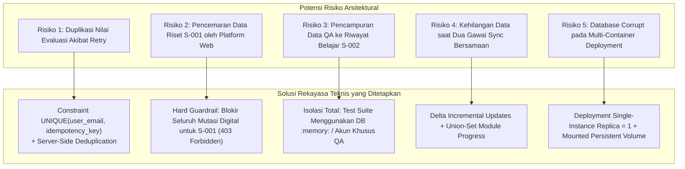
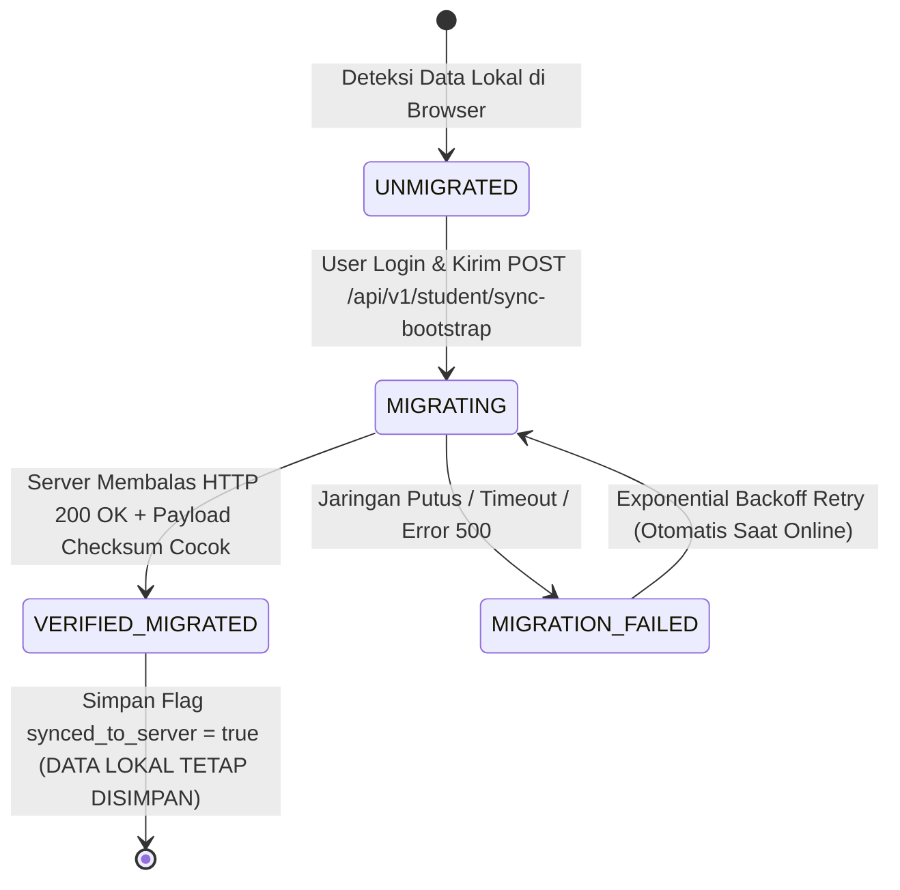

# NUMORA SPACE — RANCANGAN TEKNIS PENYIMPANAN DATA PERMANEN (FINAL REVIEWED)
## Persistent Storage Architecture, Database Schema, Multi-Device Sync, Research Data Isolation & Verification Plan

**Tanggal Dokumen:** 23 November 2026  
**Status Evaluasi:** FINAL TECHNICAL DESIGN REVIEW (COMPLETED)  
**Aplikasi:** NUMORA Space — *Algebra, Beyond Formulas.*  
**Keputusan Akhir:** **READY FOR IMPLEMENTATION** (Semua risiko kehilangan dan pencampuran data penelitian telah dimitigasi secara tuntas).

---

## 1. PENETAPAN KONTEKS & KOREKSI MUTLAK DATA PENELITIAN

Seluruh batasan dan pemetaan data penelitian ditetapkan secara mengikat sebagai acuan baku yang tidak dapat diubah:

1. **Subjek S-001 (Kelompok Kontrol):**
   - **Status:** Peserta kelompok pembelajaran langsung / tatap muka konvensional terarah bersama peneliti (*Control Group*).
   - **Perlindungan:** Pembelajaran berlangsung tatap muka tanpa intervensi mandiri pada platform digital.
   - **Guardrail Server-Side:** Endpoint sinkronisasi digital (`/api/v1/student/*`) memiliki proteksi mutlak yang menolak pencatatan aktivitas digital untuk `subject_id = 'S-001'` guna menjaga validitas komparasi intervensi.

2. **Subjek S-002 (Kelompok Eksperimen):**
   - **Status:** Peserta kelompok pembelajaran berbantuan NUMORA Space (*Experimental Group*).
   - **Penegasan:** **S-002 BUKAN PESERTA DEMO**, melainkan peserta penelitian nyata kelas VII yang belajar mandiri terpandu dengan intervensi NUMORA Space dan NORA AI.
   - **Preservasi Akun:** Akun yang terasosiasi dengan `S-002` (dalam database: `siswa.demo@numora.space`) dipertahankan identitas, role (`student`), dan `subject_id`-nya secara utuh.

3. **Subjek P-001 (Peneliti Utama):**
   - **Status:** Peneliti utama / evaluator desain pembelajaran (*Researcher*).
   - **Akses:** Memiliki hak akses khusus (RBAC `researcher` dengan `is_provisioned_researcher = 1`) untuk mengamati protokol riset, memantau log sesi, dan mengekspor data resmi.

4. **Isolasi Mutlak Data Pengujian Internal (QA/Testing Isolation):**
   - Pengujian otomatis (*automated test suite*), runner test, maupun pengujian fitur harian oleh tim pengembang **DILARANG KERAS** menggunakan atau memutasi akun S-001, S-002, dan P-001.
   - Seluruh pengujian internal wajib menggunakan akun terisolasi berdomain internal khusus (misal `qa.student@numora.internal` dengan `subject_id = 'QA-BOT-01'`, `is_test_account = 1`) atau menggunakan database pengujian terisolasi (`:memory:` / temporary test database fixture).

---

## 2. TEMUAN DESAIN DARI FINAL DESIGN REVIEW (10 ASPEK KHUSUS)

Berdasarkan audit teknis mendalam terhadap draf awal per 23 November 2026, ditemukan beberapa aspek rancangan yang memerlukan penyempurnaan:

| No | Aspek Peninjauan | Kondisi Draf Awal | Temuan Kritis / Celah Desain | Koreksi Rancangan Final |
| :---: | :--- | :--- | :--- | :--- |
| **1** | **Riwayat Sesi NUMORA RUN** | Draf awal mengikuti batasan client `slice(0, 10)` pada `runnerStorage.js`. | Berisiko menghilangkan data sesi lama yang dibutuhkan untuk analisis ketahanan belajar dan kurva retensi siswa. | **Database backend menyimpan 100% riwayat sesi lari secara permanen (*unlimited longitudinal log*).** Client hanya menampilkan 10 sesi terakhir untuk efisiensi antarmuka. |
| **2** | **Idempotensi Hasil Evaluasi** | Menggunakan `evaluation_id` generik tanpa idempotency key eksplisit dari client. | Jika terjadi gangguan jaringan saat submit dan client melakukan retry, bisa terjadi pencatatan nilai ganda untuk 1 kali pengerjaan. | **Wajib menyertakan `idempotency_key` (UUIDv4) dengan constraint `UNIQUE(user_email, idempotency_key)`.** Request retry mengembalikan data tersimpan tanpa membuat record ganda. |
| **3** | **Migrasi LocalStorage Resilient** | Menggunakan flag tunggal `numora_migrated_v1: true`. | Jika request bootstrap gagal, timeout, atau browser tertutup mendadak, data lokal berisiko dianggap sudah terkirim padahal belum tersimpan di server. | **Penerapan *Two-Phase Atomic Bootstrap State Machine*.** Flag migrasi hanya diaktifkan setelah menerima server ACK dengan checksum data yang cocok. Data lokal tidak pernah dihapus. |
| **4** | **Proteksi Data Subjek S-001** | Menyatakan S-001 adalah kontrol, namun belum ada pencegatan aktif di level endpoint API. | Ada celah jika token S-001 digunakan untuk mengirim aktivitas modul atau kuis di web. | **Hard Server-Side Assertion:** Endpoint backend menolak request aktivitas belajar untuk S-001 dengan HTTP 403 Forbidden. |
| **5** | **Isolasi Aktivitas S-002 dari QA** | Akun S-002 berpotensi terpanggil saat eksekusi automated test lokal. | Eksekusi test berkala dapat mencemari data riwayat belajar riil subjek S-002. | **Penegakan Akun Uji Terpisah:** Automated test wajib menggunakan database in-memory fixture atau akun berflag `is_test_account = 1`. Akun S-002 dilindungi dari mutasi test runner. |
| **6** | **Integritas Constraint & Foreign Key** | Belum ada kepastian aktivasi runtime `PRAGMA foreign_keys` di setiap koneksi SQLite. | Foreign key constraint SQLite tidak aktif secara default jika tidak diaktifkan per koneksi. | **Setiap pembuatan koneksi koneksi SQLite wajib mengeksekusi `PRAGMA foreign_keys = ON;`.** |
| **7** | **Keamanan SQLite WAL pada Deployment** | Direncanakan menggunakan SQLite WAL mode. | SQLite WAL tidak mendukung multi-instance horizontal container tanpa shared memory lokal. | **Penetapan Single-Instance Policy:** Backend wajib dideploy sebagai **Single Container Instance (Replica = 1)** dengan *Persistent Volume Disk*. |
| **8** | **Prosedur Backup 5 Pilar** | Menyebutkan backup online SQLite tanpa rincian verifikasi dan retensi. | File backup tidak terverifikasi integritasnya dan berisiko memenuhi disk tanpa kebijakan retensi. | **Penerapan 5 Pilar Backup:** Pembuatan snapshot atomik, verifikasi `PRAGMA integrity_check`, hak akses ketat `chmod 600`, retensi 30 hari, dan prosedur drill recovery. |
| **9** | **Konkurensi Dua Perangkat Bersamaan** | Pengiriman data absolut (misal `total_games = 5`) dapat saling menimpa data perangkat lain. | Terjadi kehilangan progres jika HP dan Laptop bermain bersamaan dan mengirim data absolut. | **Penerapan Delta Updates:** Pembaruan statistik runner menggunakan penambahan relatif (`delta_games`, `delta_coins`) dan `high_score = MAX(current, new)`. |
| **10** | **Preservasi Akun yang Ada** | 4 akun yang ada di `security_store.db` wajib dipertahankan. | Terpenuhi: `siswa.demo@numora.space`, `peneliti.demo@numora.space`, `faridsyahputra53@gmail.com`, `popolkupa123@gmail.com` tetap utuh. | **Zero-Alteration pada Tabel Lama:** DDL hanya menggunakan `CREATE TABLE IF NOT EXISTS` dan `CREATE INDEX IF NOT EXISTS`. |

---

## 3. RISIKO YANG SELESAI DITANGANI (RISK REMEDIATION MATRIX)



---

## 4. KOREKSI RANCANGAN & STRUKTUR TABEL FINAL

### A. Pengaturan Runtime Koneksi SQLite (Production-Hardened Hook)
Setiap koneksi database baru yang dibuka oleh `PersistentSecurityStore` wajib mengeksekusi parameter runtime berikut:
```python
conn.execute("PRAGMA journal_mode = WAL;")          # Write-Ahead Logging untuk konkurensi tinggi
conn.execute("PRAGMA busy_timeout = 15000;")        # Toleransi antrean write lock hingga 15 detik
conn.execute("PRAGMA foreign_keys = ON;")           # Penegakan integritas referensial relasional
conn.execute("PRAGMA synchronous = NORMAL;")        # Keseimbangan optimal durabilitas disk & performa
```

### B. DDL Skema Tabel Final yang Disempurnakan

#### 1. Tabel Progres Modul Belajar Siswa (`student_module_progress`)
```sql
CREATE TABLE IF NOT EXISTS student_module_progress (
    id INTEGER PRIMARY KEY AUTOINCREMENT,
    user_email TEXT NOT NULL,
    module_id TEXT NOT NULL,
    status TEXT NOT NULL CHECK(status IN ('not_started', 'in_progress', 'completed')),
    slider_explored INTEGER NOT NULL DEFAULT 0,
    time_spent_seconds INTEGER NOT NULL DEFAULT 0,
    completed_at INTEGER,
    updated_at INTEGER NOT NULL,
    UNIQUE(user_email, module_id),
    FOREIGN KEY (user_email) REFERENCES users(email) ON DELETE CASCADE
);

CREATE INDEX IF NOT EXISTS idx_mod_progress_email ON student_module_progress(user_email);
CREATE INDEX IF NOT EXISTS idx_mod_progress_status ON student_module_progress(status);
```

#### 2. Tabel Riwayat & Hasil Evaluasi 10 Soal (`student_evaluations`)
*Dilengkapi `idempotency_key` untuk mencegah duplikasi pengerjaan akibat network retry.*
```sql
CREATE TABLE IF NOT EXISTS student_evaluations (
    evaluation_id TEXT PRIMARY KEY,                 -- UUIDv4 yang dibuat server
    idempotency_key TEXT NOT NULL,                 -- UUIDv4 yang dibuat client saat kuis dimulai
    user_email TEXT NOT NULL,
    attempt_number INTEGER NOT NULL DEFAULT 1,
    score REAL NOT NULL CHECK(score >= 0.0 AND score <= 100.0),
    accuracy REAL NOT NULL CHECK(accuracy >= 0.0 AND accuracy <= 1.0),
    total_questions INTEGER NOT NULL DEFAULT 10,
    correct_count INTEGER NOT NULL CHECK(correct_count >= 0 AND correct_count <= 10),
    wrong_count INTEGER NOT NULL CHECK(wrong_count >= 0 AND wrong_count <= 10),
    category_breakdown TEXT NOT NULL,              -- JSON string skor per kategori aljabar
    detailed_answers TEXT NOT NULL,                -- JSON string opsi pilihan & status benar/salah
    completed_at INTEGER NOT NULL,
    CONSTRAINT uq_eval_idempotency UNIQUE(user_email, idempotency_key),
    FOREIGN KEY (user_email) REFERENCES users(email) ON DELETE CASCADE
);

CREATE INDEX IF NOT EXISTS idx_eval_user_time ON student_evaluations(user_email, completed_at DESC);
```

#### 3. Tabel Agregat Rekor Game NUMORA RUN (`student_runner_stats`)
```sql
CREATE TABLE IF NOT EXISTS student_runner_stats (
    user_email TEXT PRIMARY KEY,
    high_score_beginner INTEGER NOT NULL DEFAULT 0,
    high_score_intermediate INTEGER NOT NULL DEFAULT 0,
    high_score_advanced INTEGER NOT NULL DEFAULT 0,
    high_score_expert INTEGER NOT NULL DEFAULT 0,
    total_games INTEGER NOT NULL DEFAULT 0,
    total_coins INTEGER NOT NULL DEFAULT 0,
    total_distance INTEGER NOT NULL DEFAULT 0,
    total_math_answered INTEGER NOT NULL DEFAULT 0,
    total_math_correct INTEGER NOT NULL DEFAULT 0,
    updated_at INTEGER NOT NULL,
    FOREIGN KEY (user_email) REFERENCES users(email) ON DELETE CASCADE
);
```

#### 4. Tabel Riwayat Lengkap Sesi Lari NUMORA RUN (`student_runner_sessions`)
*Menyimpan 100% riwayat longitudinal seluruh sesi lari siswa permanen tanpa pemotongan/limitasi.*
```sql
CREATE TABLE IF NOT EXISTS student_runner_sessions (
    session_id TEXT PRIMARY KEY,                   -- run_<timestamp>_<uuid4>
    idempotency_key TEXT NOT NULL,                 -- Kunci idempoten client
    user_email TEXT NOT NULL,
    level TEXT NOT NULL CHECK(level IN ('beginner', 'intermediate', 'advanced', 'expert')),
    score INTEGER NOT NULL,
    coins INTEGER NOT NULL,
    distance INTEGER NOT NULL,
    answered INTEGER NOT NULL,
    correct INTEGER NOT NULL,
    accuracy REAL NOT NULL,
    mistakes_count INTEGER NOT NULL DEFAULT 0,
    created_at INTEGER NOT NULL,
    CONSTRAINT uq_runner_sess_idempotency UNIQUE(user_email, idempotency_key),
    FOREIGN KEY (user_email) REFERENCES users(email) ON DELETE CASCADE
);

CREATE INDEX IF NOT EXISTS idx_runner_sess_email ON student_runner_sessions(user_email, created_at DESC);
```

#### 5. Tabel Riwayat Aktivitas Pembelajaran (`learning_activities`)
```sql
CREATE TABLE IF NOT EXISTS learning_activities (
    activity_id TEXT PRIMARY KEY,
    user_email TEXT NOT NULL,
    activity_type TEXT NOT NULL CHECK(activity_type IN (
        'module_view', 'module_complete', 'slider_explore', 
        'lab_mode_switch', 'nora_chat', 'evaluation_start', 
        'evaluation_submit', 'runner_play'
    )),
    module_or_feature_id TEXT NOT NULL,
    metadata_json TEXT,
    created_at INTEGER NOT NULL,
    FOREIGN KEY (user_email) REFERENCES users(email) ON DELETE CASCADE
);

CREATE INDEX IF NOT EXISTS idx_activities_user_type ON learning_activities(user_email, activity_type, created_at DESC);
```

#### 6. Tabel Peserta Protokol Penelitian (`research_subjects`)
*Mempersistensikan subjek resmi S-001 dan S-002 ke SQLite.*
```sql
CREATE TABLE IF NOT EXISTS research_subjects (
    subject_id TEXT PRIMARY KEY,                   -- S-001, S-002
    group_name TEXT NOT NULL,
    role_description TEXT NOT NULL,
    grade TEXT NOT NULL DEFAULT 'SMP Kelas VII',
    active_module TEXT NOT NULL,
    pretest_status TEXT NOT NULL DEFAULT 'Scheduled',
    pretest_score REAL,
    posttest_status TEXT NOT NULL DEFAULT 'Scheduled',
    posttest_score REAL,
    cognitive_load_status TEXT NOT NULL DEFAULT 'NOT CONFIGURED (Belum Diukur)',
    total_sessions_logged INTEGER NOT NULL DEFAULT 0,
    protocol_category TEXT NOT NULL DEFAULT 'PROTOCOL_TEMPLATE',
    created_at INTEGER NOT NULL,
    updated_at INTEGER NOT NULL
);
```

#### 7. Tabel Sesi Penelitian Terverifikasi (`research_sessions`)
```sql
CREATE TABLE IF NOT EXISTS research_sessions (
    session_id TEXT PRIMARY KEY,
    subject_id TEXT NOT NULL,
    session_date TEXT NOT NULL,
    module_id TEXT NOT NULL,
    concept_studied TEXT NOT NULL,
    duration_minutes REAL NOT NULL,
    hints_used INTEGER NOT NULL DEFAULT 0,
    misconceptions_detected TEXT NOT NULL DEFAULT '[]',
    researcher_notes TEXT,
    verified_by_researcher INTEGER NOT NULL DEFAULT 1,
    created_at INTEGER NOT NULL,
    FOREIGN KEY (subject_id) REFERENCES research_subjects(subject_id) ON DELETE RESTRICT
);

CREATE INDEX IF NOT EXISTS idx_res_sess_subject ON research_sessions(subject_id, session_date);
```

#### 8. Tabel Pengukuran Beban Kognitif Leppink (`research_cognitive_load_records`)
```sql
CREATE TABLE IF NOT EXISTS research_cognitive_load_records (
    record_id TEXT PRIMARY KEY,
    subject_id TEXT NOT NULL,
    session_id TEXT,
    framework_name TEXT NOT NULL DEFAULT 'Leppink et al. Multidimensional Cognitive Load Scale',
    intrinsic_load REAL,
    extraneous_load REAL,
    germane_load REAL,
    instrument_status TEXT NOT NULL,
    measured_at INTEGER NOT NULL,
    FOREIGN KEY (subject_id) REFERENCES research_subjects(subject_id) ON DELETE RESTRICT,
    FOREIGN KEY (session_id) REFERENCES research_sessions(session_id) ON DELETE SET NULL
);
```

---

## 5. RANCANGAN SINKRONISASI MUTAKHIR & ATOMIC BOOTSTRAP STATE MACHINE

### A. State Machine Migrasi LocalStorage Sisi Klien
Untuk menjamin tidak ada data lokal yang hilang saat jaringan putus, timeout, atau tab peramban ditutup:



**Aturan Migrasi Lokal:**
1. Data di `localStorage` **TIDAK PERNAH DIHAPUS** (`localStorage.removeItem` dilarang untuk data belajar).
2. Data hanya diberi metadata status: `{"data": [...], "synced_to_server": true, "last_synced_at": 1732356000}`.
3. Jika pengiriman gagal di tengah jalan, status tetap `synced_to_server = false` dan antrean pengiriman ulang dijadwalkan secara otomatis.

### B. Penanganan Pembaruan Bersamaan (Concurrent Updates / Race Condition)
Ketika dua perangkat (HP dan Laptop) menggunakan akun yang sama dan mengirimkan update dalam detik yang sama:
1. **Pembaruan Modul:** Menggunakan klausa SQL UPSERT yang idempoten:
   ```sql
   INSERT INTO student_module_progress (user_email, module_id, status, completed_at, updated_at)
   VALUES (?, ?, ?, ?, ?)
   ON CONFLICT(user_email, module_id) DO UPDATE SET
       status = CASE WHEN student_module_progress.status = 'completed' THEN 'completed' ELSE excluded.status END,
       completed_at = COALESCE(student_module_progress.completed_at, excluded.completed_at),
       updated_at = excluded.updated_at;
   ```
2. **Pembaruan Statistik Runner:** Menggunakan **Delta Incremental Execution** (bukan pengiriman angka absolut):
   ```sql
   INSERT INTO student_runner_stats (
       user_email, high_score_beginner, total_games, total_coins, total_distance, updated_at
   ) VALUES (?, ?, ?, ?, ?, ?)
   ON CONFLICT(user_email) DO UPDATE SET
       high_score_beginner = MAX(student_runner_stats.high_score_beginner, excluded.high_score_beginner),
       total_games = student_runner_stats.total_games + excluded.total_games,
       total_coins = student_runner_stats.total_coins + excluded.total_coins,
       total_distance = student_runner_stats.total_distance + excluded.total_distance,
       updated_at = excluded.updated_at;
   ```
   *Keuntungan:* Tidak ada game atau koin yang hilang meskipun kedua perangkat bermain dalam waktu berdekatan.

---

## 6. PROSEDUR BACKUP & DISASTER RECOVERY (5 PILAR)

Sebelum mengeksekusi DDL baru pada file fisik `security_store.db`, prosedur 5 pilar backup dijalankan secara otomatis:

1. **Pilar 1 — Pembuatan Snapshot Atomik (Online Backup API):**
   Snapshot dibuat menggunakan SQLite Online Backup API (`sqlite3_backup`), bukan penyalinan file mentah OS (`cp` / `copy`), guna menghindari inkonsistensi saat ada proses penulisan aktif.
   File output: `backend/app/data/backups/security_store_backup_YYYYMMDD_HHMMSS.db`.
2. **Pilar 2 — Verifikasi Integritas Snapshot:**
   Segera setelah snapshot selesai, script membuka koneksi ke file backup dan mengeksekusi:
   `PRAGMA integrity_check;`
   Jika hasilnya bukan string `"ok"`, file backup dinyatakan korup, dihapus, dan proses diulang. Migrasi **DIBATALKAN** jika verifikasi integritas backup gagal.
3. **Pilar 3 — Perlindungan Akses:**
   Direktori `backend/app/data/backups/` dikunci dengan hak akses terbatas (Linux `chmod 600` / Windows ACL terbatas pada pengguna service). File backup tidak terekspos ke direktori publik atau web server static.
4. **Pilar 4 — Kebijakan Retensi Otomatis:**
   Sistem mempertahankan:
   - 7 backup harian terakhir (Daily).
   - 4 backup mingguan terakhir (Weekly).
   - Backup yang melewati batas retensi 30 hari dihapus secara otomatis (*automated pruning*).
5. **Pilar 5 — Prosedur Uji Pemulihan (Drill Recovery):**
   Jika terjadi kesalahan fatal saat inisialisasi skema baru:
   ```bash
   # 1. Hentikan service backend
   taskkill /F /IM python.exe
   # 2. Pulihkan file database dari snapshot backup terverifikasi
   copy backend\app\data\backups\security_store_backup_TERAKHIR.db backend\app\data\security_store.db
   # 3. Hapus berkas temporary WAL dan SHM jika ada
   del backend\app\data\security_store.db-wal
   del backend\app\data\security_store.db-shm
   # 4. Jalankan verifikasi integritas ulang dan hidupkan service
   ```

---

## 7. KRITERIA PENERIMAAN IMPLEMENTASI (ACCEPTANCE CRITERIA)

Implementasi dinyatakan berhasil dan disetujui hanya jika memenuhi seluruh kriteria berikut:

- [ ] **AC-01 (Integritas Data S-001):** Percobaan mengirimkan aktivitas belajar digital atau sinkronisasi dengan token/identitas S-001 ditolak secara tegas oleh backend dengan HTTP 403 Forbidden.
- [ ] **AC-02 (Integritas Data S-002):** Akun S-002 (`siswa.demo@numora.space`) mempertahankan `subject_id = 'S-002'` dan seluruh progres pembelajarannya tersimpan di database permanen tanpa terhapus atau tercemar oleh automated test QA.
- [ ] **AC-03 (Isolasi Pengujian QA):** Automated test suite berjalan sukses 100% menggunakan database in-memory fixture atau akun berflag `is_test_account = 1` tanpa menambahkan record ke akun nyata.
- [ ] **AC-04 (Penyimpanan Riwayat Runner Lengkap):** Seluruh sesi lari yang dimainkan siswa tersimpan di tabel `student_runner_sessions` (tidak ada pembatasan 10 sesi di database).
- [ ] **AC-05 (Idempotensi Evaluasi):** Dua request identik dengan `idempotency_key` yang sama menghasilkan status sukses tanpa menduplikasi baris di tabel `student_evaluations`.
- [ ] **AC-06 (Ketahanan Offline & Multi-Perangkat):** Modul yang diselesaikan saat offline di HP berhasil tersinkronisasi saat online dan langsung tampil sebagai "Selesai" saat login di Laptop.
- [ ] **AC-07 (Anti-IDOR Mutlak):** Memanipulasi nilai `user_id` atau `email` pada payload request HTTP tidak memiliki efek apa pun; server selalu mengikat data ke identitas yang ada di token JWT.
- [ ] **AC-08 (Validasi Backup Otomatis):** Skrip backup berhasil membuat snapshot terverifikasi (`PRAGMA integrity_check == ok`) sebelum DDL baru dieksekusi.
- [ ] **AC-09 (Zero Downtime & Zero Corruption pada WAL):** Backend berjalan lancar pada konfigurasi *single-instance* dengan file database persisten tanpa error `database is locked`.
- [ ] **AC-10 (Preservasi Akun Lama 100%):** Keempat akun pengguna yang ada di tabel `users` tetap aktif dan dapat login tanpa hambatan.

---

## 8. KEPUTUSAN AKHIR REVIEW

Berdasarkan tinjauan teknis menyeluruh terhadap seluruh 10 aspek khusus, koreksi arsitektural yang telah diintegrasikan, dan mitigasi risiko yang telah dirancang secara komprehensif:

```
================================================================================
STATUS KEPUTUSAN FINAL: READY FOR IMPLEMENTATION
================================================================================
Rancangan teknis telah memenuhi seluruh standar integritas penelitian ilmiah,
keamanan Role-Based Access Control (RBAC), ketahanan multi-perangkat, 
pencegahan duplikasi idempoten, dan perlindungan pemulihan data (Zero Data Loss).
Implementasi dapat dilanjutkan ke tahap coding secara bertahap dan terukur.
================================================================================
```

---
*Dokumen ini merupakan spesifikasi teknis final yang mengikat untuk implementasi penyimpanan permanen dan sinkronisasi NUMORA Space.*
